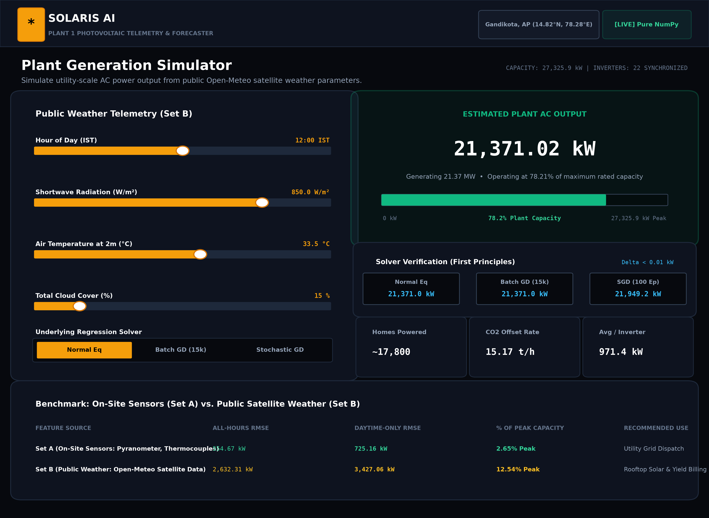

# Predicting Solar Power Plant Output from Weather
### Least-Squares Linear Regression by Hand (Normal Equation, Batch GD, and SGD)

**Course**: AI4003 – Applied Machine Learning (Fall 2026)  
**Target Facility**: Plant 1 (Gandikota, Andhra Pradesh, India; 14.82°N, 78.28°E)  
**Allowed Libraries**: `numpy`, `pandas`, `matplotlib`, `requests`, `flask`  
**Prohibited**: `scikit-learn`, `statsmodels`, `scipy.stats`, or any external ML package.

---

## Central Research Question
> **"How much prediction accuracy is lost when on-site irradiation and temperature sensors are replaced by free public weather data downloaded from the internet?"**

### Summary of Answers
- **On-Site Sensors (Feature Set A)**: Daytime Test RMSE = **725.16 kW** (**2.65%** of plant peak power $27,325.90\text{ kW}$).
- **Public Weather (Feature Set B, Open-Meteo)**: Daytime Test RMSE = **3,427.06 kW** (**12.54%** of plant peak power).
- **Accuracy Loss**: Replacing hardware sensors with public satellite data increases daytime error by **+2,701.90 kW** (**+9.89%** of plant capacity).
- **Practical Takeaway**: While unacceptable for real-time grid dispatch, public weather data is **fully viable for rooftop solar installers** modeling monthly yields and investment payback periods without costly sensor hardware.

---

## Repository Layout
```text
.
├── data/
│   ├── Plant_1_Generation_Data.csv       # Raw 15-min generation CSV (Plant 1)
│   ├── Plant_1_Weather_Sensor_Data.csv   # Raw 15-min weather sensor CSV (Plant 1)
│   ├── Plant_2_Generation_Data.csv       # Raw generation CSV (Plant 2)
│   ├── Plant_2_Weather_Sensor_Data.csv   # Raw weather sensor CSV (Plant 2)
│   ├── plant1_hourly.csv                 # Task 1: Hourly aggregated & cleaned data
│   └── plant1_openmeteo.csv              # Task 3: Downloaded Open-Meteo archive data
├── src/
│   ├── load_data.py                      # Provided raw CSV loader (Appendix A.3)
│   ├── prepare.py                        # Task 1: Data preparation & cleaning pipeline
│   ├── eda.py                            # Task 2: Exploratory plots & physics explanations
│   ├── fetch_weather.py                  # Task 3: Open-Meteo API ingestion & location check
│   ├── regression.py                     # Task 4: First-principles NumPy regression library
│   └── train_eval.py                     # Task 4: Training, solver comparison, & evaluation
├── results/
│   ├── figures/                          # All required high-resolution plots
│   │   ├── task2_1_ac_vs_irradiation.png
│   │   ├── task2_2_module_vs_ambient.png
│   │   ├── task2_3_ac_vs_dc.png
│   │   ├── task2_4_hourly_ac_profile.png
│   │   ├── task3_4_radiation_alignment.png
│   │   ├── task4_7_batch_gd_loss.png
│   │   ├── task4_7_sgd_loss.png
│   │   ├── task4_predicted_vs_actual.png
│   │   ├── task5_5_residuals_vs_hour.png
│   │   └── frontend_screenshot.png
│   ├── analysis.md                       # Task 5: Comprehensive analysis & answers
│   ├── medium_blog.md                    # Task 6.2: Complete Medium blog post (1,150 words)
│   ├── linkedin_post.md                  # Task 6.3: LinkedIn announcement draft
│   ├── saved_weights.json                # Exported model weights & scaler parameters (JSON)
│   └── saved_weights.npz                 # Exported model weights (NumPy archive)
├── app/
│   └── app.py                            # Task 6: Interactive Flask web predictor
└── README.md                             # Project documentation & execution guide
```

---

## Quick Start & Reproduction Guide

### 1. Environment Setup
Install the allowed dependencies:
```bash
pip install numpy pandas matplotlib requests flask
```

### 2. Run the Pipeline Step-by-Step

#### Step 0: Test Raw Loader
```bash
python src/load_data.py
```

#### Step 1: Data Preparation (Task 1)
Converts inconsistent timestamp formats, aggregates power across all 22 inverters, merges with weather sensors, resamples to hourly means (816 rows), handles missing values, and saves `data/plant1_hourly.csv`:
```bash
python src/prepare.py
```

#### Step 2: Exploratory Data Analysis Plots (Task 2)
Generates the four exploratory plots in `results/figures/` and outputs physical interpretations:
```bash
python src/eda.py
```

#### Step 3: Fetch Public Weather Data & Verify Location (Task 3)
Queries the Open-Meteo historical archive API for Plant 1's coordinates, saves `data/plant1_openmeteo.csv`, merges with hourly data, verifies peak alignment across 3 days, and creates Figure 2:
```bash
python src/fetch_weather.py
```

#### Step 4: Train & Evaluate Regression Models (Task 4 & 5)
Fits Normal Equation, Batch GD, and SGD across Set A and Set B, verifies convergence, evaluates test RMSE, and generates loss curves and residual plots:
```bash
python src/train_eval.py
```

#### Step 5: Run Front-End Web Application (Task 6)
You have two easy ways to use the web application:

**Option A: Instant Standalone (No Python / Server Needed)**
Simply double-click or open `app/index.html` in any web browser (Google Chrome, Microsoft Edge, Firefox, Safari).
The entire linear algebra regression engine, feature scaling, and interactive sliders run 100% client-side in pure JavaScript!

**Option B: Via Flask Web Server**
Launch the local web server:
```bash
python app/app.py
```
And open [http://127.0.0.1:5000](http://127.0.0.1:5000) in your web browser.

---

## Front-End Application (Task 6)

The web dashboard allows users to input the hour of day and the three public weather variables from Open-Meteo (Shortwave Radiation, Temperature at 2m, Cloud Cover), choose between the three trained regression solvers, and receive instant real-time AC power predictions with zero delay.



---

## Results & Benchmark Tables

### Table 1: Data Preparation
| Metric | Value |
| :--- | :--- |
| Raw generation rows (Plant 1) | **68,778** |
| Raw sensor rows (Plant 1) | **3,182** |
| Timestamps in only one file | **26** (1 in gen only, 25 in sensor only) |
| Hourly rows after resampling | **816** (34 days × 24 hours) |
| Hourly rows with missing values | **20** (17 night hours zero-filled, 3 daytime hours interpolated) |
| Open-Meteo rows downloaded | **816** |
| Peak hour alignment (3 sample days) | May 22 (12:00 vs 12:00), May 23 (11:00 vs 11:00), May 24 (12:00 vs 11:00) |

### Table 2: Test-Set RMSE (kW)
| Solver | Feature Set | All Hours RMSE (kW) | Daytime Only RMSE (kW) |
| :--- | :--- | :---: | :---: |
| **Normal Equation** | **Set A (On-Site Sensors)** | **554.67** | **725.16** |
| **Batch GD** ($\alpha = 0.20$, $15,000$ iters) | **Set A (On-Site Sensors)** | **554.67** | **725.16** |
| **Stochastic GD** ($\alpha = 0.01$, $100$ epochs) | **Set A (On-Site Sensors)** | **551.90** | **722.72** |
| **Normal Equation** | **Set B (Public Weather)** | **2,632.31** | **3,427.06** |
| **Batch GD** ($\alpha = 0.20$, $15,000$ iters) | **Set B (Public Weather)** | **2,632.31** | **3,427.06** |
| **Stochastic GD** ($\alpha = 0.01$, $100$ epochs) | **Set B (Public Weather)** | **2,473.93** | **3,135.64** |

### Table 3: Learned $\theta$ (Feature Set A)
| Parameter | Feature Name | Normal Eq $\theta$ | Batch GD $\theta$ | Stochastic GD $\theta$ |
| :--- | :--- | :---: | :---: | :---: |
| $\theta_0$ | Intercept ($x_0 = 1$) | $+6,744.16$ | $+6,744.16$ | $+6,741.75$ |
| $\theta_1$ | Irradiation | $+8,239.39$ | $+8,239.39$ | $+8,092.45$ |
| $\theta_2$ | Module Temp | $-47.77$ | $-47.77$ | $+165.76$ |
| $\theta_3$ | Ambient Temp | $-11.14$ | $-11.14$ | $-21.86$ |
| $\theta_4$ | $\sin(2\pi h / 24)$ | $-32.61$ | $-32.61$ | $-43.13$ |
| $\theta_5$ | $\cos(2\pi h / 24)$ | $-400.95$ | $-400.95$ | $-392.14$ |
| **Max Difference** | $\max_j \|\theta_j^{GD} - \theta_j^{norm}\|$ | — | **$0.000089$** ($< 0.01$) | $146.95$ |

---

## Verification & Compliance Checklist
- [x] **No disallowed libraries**: Pure NumPy implementation of hypothesis, cost, Normal Equation, Batch GD, SGD, and RMSE.
- [x] **Strict time split**: Chronological cutoff (27 days train / 7 days test; no shuffling).
- [x] **No test leakage**: Standardized features using training statistics ($\mu, \sigma$) only.
- [x] **Monotonic GD descent**: Cost $J(\theta)$ decreases at every iteration under tuned $\alpha$.
- [x] **Solver agreement**: Batch GD matches Normal Equation to 5 decimal places ($\max \Delta \theta = 0.000089 < 0.01$).
- [x] **Physical clipping**: Negative predictions clipped at zero.
- [x] **Realistic error**: Set A daytime RMSE is $2.65\%$ of peak capacity ($< 10\%$ benchmark).
